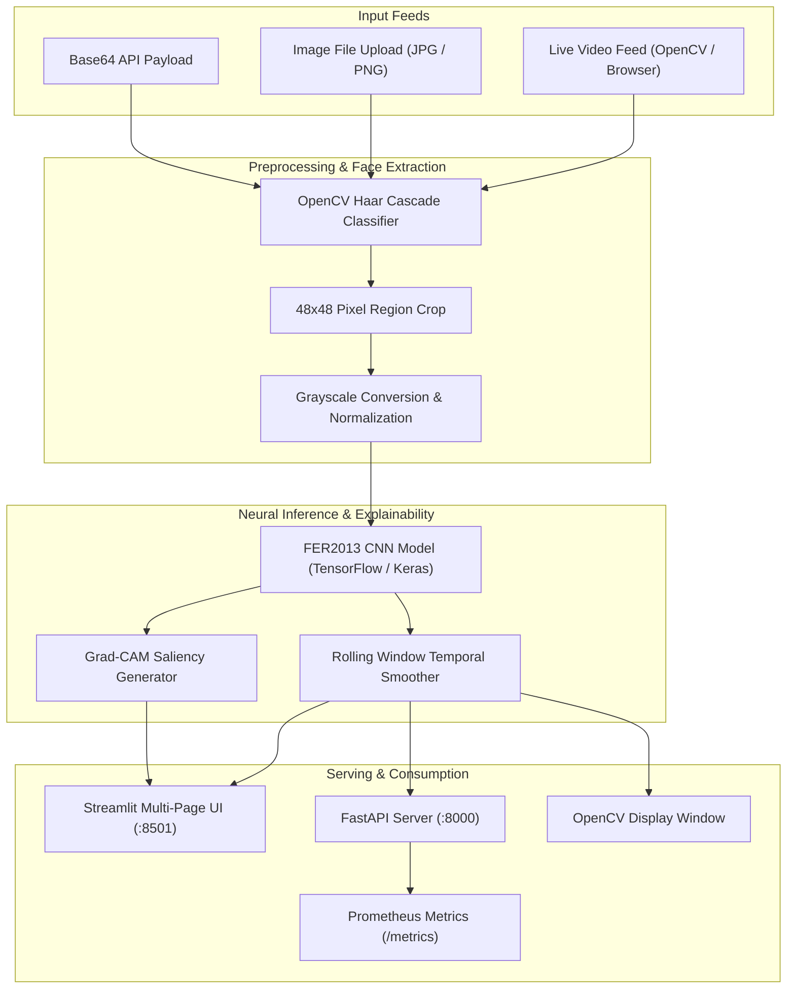

# EmotionLens

[](https://github.com/themanoj-025/Emotion-Lens/actions)
[](./LICENSE)
[](https://www.python.org/)
[](https://www.tensorflow.org/)
[](https://streamlit.io/)
[](tests/)

Real-time facial emotion recognition platform leveraging Convolutional Neural
Networks (CNN) trained on the FER2013 dataset. Ships with a 7-page Streamlit
dashboard, production FastAPI inference microservice, Grad-CAM explainability,
and live OpenCV video stream tracking.

---

## Quick Facts

| Dimension | Details |
| --- | --- |
| **Domain** | Computer Vision, Facial Emotion Recognition & Affective Computing |
| **Model Architecture** | Multi-layer CNN with Batch Normalization & Dropout trained on FER2013 |
| **Target Classes** | 7 discrete emotions (Angry, Disgust, Fear, Happy, Neutral, Sad, Surprise) |
| **Interfaces** | Streamlit multi-page UI, FastAPI async REST API, OpenCV CLI camera script |
| **Explainability** | Layer-wise Grad-CAM heatmaps visualizing facial feature activations |
| **Observability** | Structured JSON logging, Prometheus metrics (`/metrics`), optional OpenTelemetry |
| **Test Coverage** | 245 collected tests across 17 unit and integration suites |
| **License** | [MIT License](./LICENSE) |

---

## Table of Contents

- [What It Does](#what-it-does)
- [Detected Emotions](#detected-emotions)
- [Screenshots](#screenshots)
- [Key Features](#key-features)
- [Architecture](#architecture)
- [Tech Stack](#tech-stack)
- [Prerequisites](#prerequisites)
- [Quick Start](#quick-start)
- [Configuration](#configuration)
- [Project Structure](#project-structure)
- [API Reference](#api-reference)
- [Testing](#testing)
- [Limitations](#limitations)
- [Contributing](#contributing)
- [Security](#security)
- [License](#license)

---

## What It Does

Facial expression recognition is central to affective computing, human-computer
interaction, and behavioral research. However, existing implementations often
lack production readiness—neglecting model explainability, real-time temporal
smoothing, robust face tracking across variable lighting, or standardized REST APIs.

**EmotionLens** provides an end-to-end vision pipeline:
1. **Haar Cascade Face Detection:** Localizes human faces in raw video frames
   or uploaded images using OpenCV.
2. **CNN Emotion Classification:** Scales bounding crops to 48×48 grayscale
   and outputs probability vectors across 7 universal affective categories.
3. **Temporal Smoothing:** Employs rolling window buffer smoothing to stabilize
   predictions across continuous video frames and eliminate flicker.
4. **Grad-CAM Saliency:** Generates gradient-weighted class activation maps
   highlighting the exact facial regions (eyebrows, mouth, eyes) driving predictions.
5. **Interactive UI & Service API:** Offers an accessible 7-page Streamlit portal
   for exploration alongside a FastAPI service equipped with authentication,
   rate limiting, and Prometheus telemetry.

---

## Detected Emotions

The underlying CNN classifies crops into 7 mutually exclusive affective
categories according to the FER2013 benchmark:

| Emotion | Description | Visual Cues |
| --- | --- | --- |
| **Angry** | Intense displeasure or frustration | Furrowed brow, tightened lips, glaring eyes |
| **Disgust** | Aversion or distaste | Wrinkled nose, raised upper lip |
| **Fear** | Apprehension or distress | Raised eyebrows, widened eyes, parted lips |
| **Happy** | Joy, contentment, satisfaction | Raised mouth corners (smile), cheek crinkling |
| **Neutral** | Absence of overt affective signal | Relaxed facial muscles, baseline expression |
| **Sad** | Low affect, sorrow, grief | Downturned mouth corners, drooped eyelids |
| **Surprise** | Startle or unexpected sensation | Arched eyebrows, wide open eyes, open jaw |

---

## Screenshots

<!-- TODO[L2-01]: Add live camera bounding box and Grad-CAM screenshots from running Streamlit app -->
> *Live webcam tracking with confidence overlays, temporal stability graphs, and Grad-CAM activation maps.*

---

## Key Features

- **Multi-Modal Interfaces:** Choose between an interactive web portal (`streamlit_app.py`),
  a production HTTP inference daemon (`api_server.py`), or a low-latency CLI camera loop (`webcam_inference.py`).
- **Temporal Prediction Smoother:** Rolling FIFO buffer filters out transient
  micro-expressions and detector jitter for stable real-time scoring.
- **Explainable AI (Grad-CAM):** Inspect convolution layer activations overlaid
  onto face crops to verify whether eyebrows, mouth corners, or artifacts influence decisions.
- **7 Streamlit Exploratory Pages:** Dedicated modules for live webcam inference,
  static image analysis, emotion analytics, in-browser model retraining, model inspection,
  an interactive "Emotion Game", and architecture documentation.
- **Hardened HTTP Service:** FastAPI backend incorporates SlowAPI rate limiting,
  optional bearer token authentication, CORS middleware, and Prometheus metrics.

---

## Architecture



### Component Details

- **`inference.py`**: Shared inference engine performing image decoding, face
  detection, bounding crop extraction, CNN inference, and Grad-CAM synthesis.
- **`api_server.py`**: Production-grade async FastAPI application with OpenAPI
  documentation at `/docs`, structured JSON logs, and rate limit protections.
- **`utils/`**: Modular utilities handling model downloading (`kagglehub` fallback),
  session state management, chart generation, and data export.

---

## Tech Stack

| Component | Library / Tool | Version | Role |
| --- | --- | --- | --- |
| **Language** | Python | `>=3.10` | Primary typed runtime |
| **Deep Learning** | TensorFlow / Keras | `2.21.0` | CNN inference, layer hooks, training |
| **Vision** | OpenCV Contrib Headless | `4.14.0` | Face detection (Haar Cascade), drawing |
| **Dashboard** | Streamlit | `1.65.0` | Interactive multi-page web application |
| **API** | FastAPI & Uvicorn | `>=0.143.0` | Async REST service with OpenAPI documentation |
| **Rate Limiter** | SlowAPI | `>=0.1.10` | IP-based request throttling |
| **Observability** | Prometheus Client | `>=0.26.0` | Real-time inference latency and counter metrics |
| **Visualizations** | Plotly & Matplotlib | Latest | Radar distributions and Grad-CAM heatmaps |
| **Data Utilities** | Pandas, NumPy, Pillow | Latest | Image arrays, dataframes, session exports |

---

## Prerequisites

- **Python 3.10+**
- **Webcam** (optional, required for live video tracking)
- **uv** (recommended) or standard `pip`
- Optional: **Docker** for containerized deployment

---

## Quick Start

### 1. Clone & Set Up Virtual Environment

```bash
git clone https://github.com/themanoj-025/Emotion-Lens.git
cd Emotion-Lens
```

#### Windows (PowerShell)

```powershell
python -m venv .venv
.venv\Scripts\Activate.ps1
pip install -r requirements.txt
Copy-Item .env.example .env
```

#### Linux / macOS

```bash
python3 -m venv .venv
source .venv/bin/activate
pip install -r requirements.txt
cp .env.example .env
```

### 2. Launch the Streamlit Dashboard

```bash
streamlit run streamlit_app.py
```

The interactive portal will open in your default browser at [http://localhost:8501](http://localhost:8501).

### 3. Launch the FastAPI REST Server

In a separate terminal:

```bash
uvicorn api_server:app --host 0.0.0.0 --port 8000 --reload
```

*Expected output:*
```text
{"timestamp": "...", "level": "INFO", "message": "EmotionLens model loaded successfully"}
{"timestamp": "...", "level": "INFO", "message": "FastAPI server running on http://0.0.0.0:8000"}
```

Explore OpenAPI interactive docs at [http://localhost:8000/docs](http://localhost:8000/docs).

### 4. Direct OpenCV Desktop Camera (No Browser)

```bash
python webcam_inference.py
```

Press `q` on the keyboard to exit the OpenCV video window.

---

## Configuration

Configuration parameters can be defined in `.env` or set directly as environment variables:

| Variable | Default | Secret? | Description |
| --- | --- | --- | --- |
| `EMOTION_API_KEY` | `""` | Yes | Optional bearer key to protect `/api/v1/predict*` endpoints |
| `API_HOST` | `0.0.0.0` | No | Host binding for FastAPI server |
| `API_PORT` | `8000` | No | Port binding for FastAPI server |
| `CORS_ORIGINS` | `http://localhost:8000,...` | No | Comma-separated list of permitted CORS origins |
| `OTEL_ENABLED` | `false` | No | Toggle OpenTelemetry distributed tracing export |

---

## Project Structure

```text
Emotion-Lens/
├── pages/                      # Streamlit multi-page dashboard modules
│   ├── 1_Live_Camera.py        # Real-time webcam classification & radar chart
│   ├── 2_Image_Analysis.py     # Upload image, crop faces, and Grad-CAM
│   ├── 3_Analytics.py          # Session historical trends and distribution
│   ├── 4_Train_Model.py        # Browser-driven CNN retraining on FER2013
│   ├── 5_Model_Inspector.py    # Architecture viewer, weights & parameters
│   ├── 6_Emotion_Game.py       # Gamified facial mimicry challenges
│   └── 7_About.py              # Technical docs, ethics, and citations
├── utils/                      # Modular application helpers
│   ├── chart_utils.py          # Plotly radar and distribution plots
│   ├── emotion_utils.py        # Label mappings and emotion metadata
│   ├── export_utils.py         # CSV and JSON prediction export tools
│   ├── gradcam_utils.py        # Grad-CAM heatmap overlay computation
│   ├── model_utils.py          # Model artifact loading, cache & download
│   ├── session_utils.py        # Streamlit session memory persistence
│   └── smoothing_utils.py      # Rolling buffer temporal smoother
├── tests/                      # Pytest suite (245 unit and integration tests)
├── api_models.py               # Pydantic schemas and shared API constants
├── api_routes.py               # Auxiliary routing helpers
├── api_server.py               # Production FastAPI service with rate limits
├── inference.py                # Core image transformation and CNN prediction engine
├── streamlit_app.py            # Primary Streamlit landing page
├── train.py                    # Standalone CNN training script on FER2013
├── webcam_inference.py         # Standalone desktop OpenCV video loop
├── Dockerfile                  # Container definition with OpenCV dependencies
├── docker-compose.yml          # Container configuration
├── pyproject.toml              # Ruff, black, pytest and tool settings
├── requirements.txt            # Locked package dependencies
└── README.md
```

---

## API Reference

| Method | Endpoint | Auth | Description |
| --- | --- | --- | --- |
| `GET` | `/` | Public | Service metadata and version information |
| `GET` | `/health` | Public | Liveness check reporting loaded model status |
| `GET` | `/metrics` | Public | Prometheus scraping endpoint for request latency and counters |
| `POST` | `/api/v1/predict` | Optional | Classify emotion from base64-encoded image string |
| `POST` | `/api/v1/predict-file` | Optional | Classify emotion from multipart uploaded image file |

### Sample Request (`/api/v1/predict`)

```bash
curl -X POST "http://localhost:8000/api/v1/predict" \
     -H "Content-Type: application/json" \
     -d '{"image": "data:image/jpeg;base64,..."}'
```

---

## Testing

The test suite covers model loading, Haar face cropping, Grad-CAM generation,
temporal smoothing, API error boundaries, rate limits, and authentication.

```bash
# Run all tests
pytest tests/ -v -o addopts=""

# Run with test coverage report
pytest tests/ --cov=. -o addopts=""
```

All external model downloads and network requests are mocked in test suites,
enabling fast, deterministic offline execution.

---

## Limitations

- **Grayscale Low-Resolution Inputs:** The underlying CNN processes 48×48 grayscale
  crops; subtle nuances or micro-expressions in high-definition video may lose fidelity.
- **Lighting & Occlusion Sensitivity:** Haar Cascade face detection can struggle
  under extreme yaw/pitch angles, heavy shadows, or partial face coverings.
- **Cultural & Contextual Variance:** Emotion recognition systems map discrete
  facial muscle configurations to fixed labels; human emotion in natural environments
  is context-dependent and multi-faceted.

---

## Contributing

Contributions are welcome! Please follow these steps:

1. Fork the repository.
2. Create your feature branch: `git checkout -b feat/my-improvement`.
3. Verify linting and formatting: `ruff check .` and `black .`.
4. Run all tests: `pytest tests/ -o addopts=""`.
5. Open a pull request against `main`.

See [CONTRIBUTING.md](./CONTRIBUTING.md) for complete guidelines.

---

## Security

Please report vulnerabilities privately via GitHub Security Advisories or by
contacting the repository maintainers. Never commit sensitive keys or personal data.
See [SECURITY.md](./SECURITY.md) for our disclosure policy.

---

## License

This project is licensed under the [MIT License](./LICENSE).
